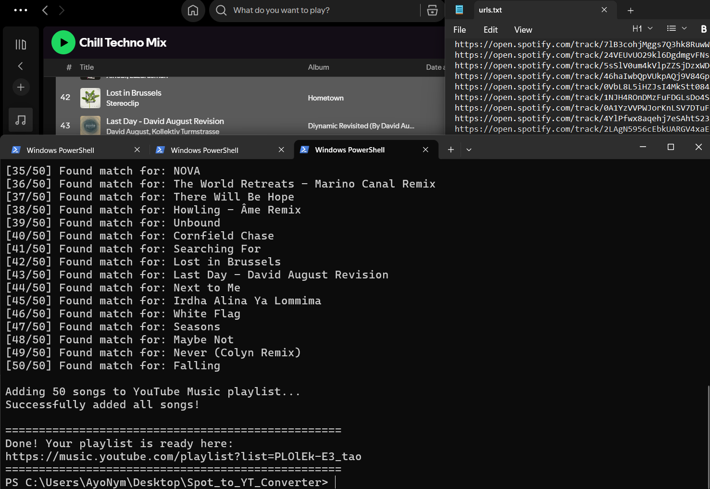
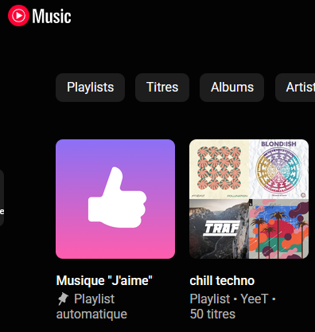

# Spotify to YouTube Music Converter

A free, local, self-hosted Python script to convert Spotify tracks into a YouTube Music playlist. No Spotify Premium required. No Google Cloud Developer account required. No 500-song limits.

## How It Works

1. The script reads Spotify track URLs from `urls.txt` (Single Mode) or `batch.txt` (Batch Mode).
2. It securely scrapes Spotify's embed pages to extract the exact Song Title and Artist Name, bypassing their bot protection.
3. It authenticates with YouTube Music using a secure, local browser session.
4. It searches YouTube Music for the exact match and **strictly verifies the artist** to prevent imposter songs/covers from being added.
5. It creates a private YouTube Music playlist and adds all the songs in batches.
6. It prints a direct link to your new playlist(s).

## Screenshots

**1. Searching, Converting and Link (`converter.py`)**



**2. Final Result**



## Prerequisites

1. Python 3.8+ installed on your computer.
2. Google Chrome installed on your computer (required for the automated login script).

## Setup Instructions

1. **Install the required Python libraries:**
   ```bash
   pip install undetected-chromedriver requests
   ```

2. **Authenticate YouTube Music (One-time setup):**
   - Run `python auto_auth.py`
   - A special Chrome window will open to YouTube Music.
   - Click "Sign In" and log into your Google account.
   - Once you see your profile picture on YouTube Music, go back to your terminal and press `ENTER`.
   - This generates a `browser.json` file containing your login session (valid for up to 2 years).

## How to Use

### Option A: Single Playlist Mode
1. Create a file named `urls.txt` in the same folder.
2. Paste your Spotify track URLs inside (one per line). 
   *Example:* `https://open.spotify.com/track/4cOdK2wGLETKBW3PvgPWqT`
3. Run `python converter.py`.
4. Type a name for your new playlist when prompted (or press Enter for the default "Spotify Import").

### Option B: Batch Mode (Multiple Playlists at once)
1. Create a file named `batch.txt` in the same folder.
2. Format it by putting the Playlist Name on one line, followed by the URLs on the next lines. Separate playlists with an empty line:
   ```text
   My Ambient Playlist
   https://open.spotify.com/track/abc123
   https://open.spotify.com/track/def456

   Workout Mix
   https://open.spotify.com/track/ghi789
   https://open.spotify.com/track/jkl012
   ```
3. Run `python converter.py`. The script will automatically detect `batch.txt`, process the first playlist, wait 5 seconds, process the next, and output all links at the end.

*(Note: If `batch.txt` exists, the script will ignore `urls.txt` and run in Batch Mode. To use Single Mode again, simply delete or rename `batch.txt`)*.

## Troubleshooting

- **Error: `SAPISID cookie not found` or `401 Unauthorized`**
  - Your YouTube Music login has expired. Simply run `python auto_auth.py` again to generate a fresh `browser.json` file.
  
- **Error: `This browser or app may not be secure`**
  - Ensure you are running the latest version of `undetected-chromedriver` (`pip install --upgrade undetected-chromedriver`).
  - Ensure all background Google Chrome processes are fully closed before running the auth script.

- **Error: `invalid session id`**
  - The Chrome window was closed before the script could extract cookies. Do not close the Chrome window manually; just log in and press ENTER in the terminal.

- **Songs are being `Skipped (artist mismatch on YouTube)`**
  - The script strictly verifies that the artist on YouTube matches the artist on Spotify. If YouTube only has a cover or remix by a different artist, it will skip it to protect your playlist.

- **Spotify Rate Limits (`Waiting 10 seconds...`)**
  - If you are converting massive playlists, Spotify might temporarily block your IP. The script will automatically pause and retry.

## Disclaimer
This project is for educational purposes only. It automates browser actions to interact with YouTube Music's internal API. Use it responsibly and respect the terms of service of both Spotify and YouTube.
## Self-Hosted Web Application (Docker)

This project includes a Flask web interface for managing playlist conversion and media jobs.

### Requirements

- Docker Engine and Docker Compose
- An authenticated YouTube Music session stored locally as browser.json

### Setup

1. Copy the environment template: `cp .env.example .env`
2. Set your own BRIDGE_USER and BRIDGE_PASSWORD values in .env. Use a long, random password.
3. Place your private browser.json file in the project directory. Never commit it to GitHub.
4. Create runtime directories: `mkdir -p downloads monitoring`
5. Build and start the application: `docker compose -f compose.example.yaml up -d --build`
6. Review logs: `docker compose -f compose.example.yaml logs --tail=100`

The example configuration binds port 8088 to localhost only by default.

### Security

- Never commit .env, browser.json, browser profiles, downloads, monitoring state, or databases.
- Do not expose the application directly to the public internet without suitable access controls and HTTPS.
- Only download or convert media you are authorized to access.
